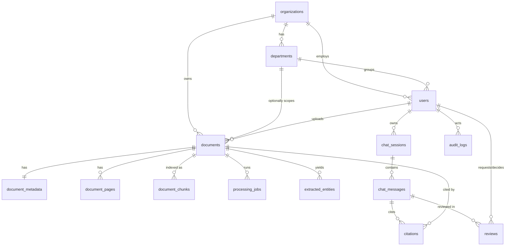

# Database design (MySQL via Laravel migrations)

Migrations: `2026_01_01_0001…0004` in `laravel-overlay/database/migrations`. The skeleton's own migrations (users, cache, jobs, sessions) run first; `0200` adds `organization_id`, `department_id`, `role`, `is_active` to `users`.

| Table | Notes |
|---|---|
| organizations, departments | unique names/codes; `restrictOnDelete` (deactivate instead of delete) |
| users | role string, nullable org/dept (Super Admin has none), `is_active` |
| documents | `uuid` unique; `stored_path` hidden from serialization; soft deletes; `archived_at`; indexes on (org, dept), category, status |
| document_metadata | 1:1; extracted/edited fields + cached `summary` JSON |
| document_pages | page-level text (used for keyword search and snippets); unique (document, page) |
| document_chunks | references to vector records (chunk id, page); unique (document, chunk_id) |
| processing_jobs | one row per attempt with error code/message |
| extracted_entities | typed values with page and evidence |
| chat_sessions / chat_messages / citations | private to the session owner |
| reviews | pending / verified / rejected / needs_correction, reviewer, timestamp, comment |
| audit_logs | append-only (no `updated_at`); metadata JSON never receives passwords/secrets |

Original PDFs are **not** stored in MySQL; they live on the private disk (`storage/app/private`).
